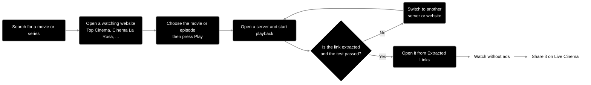



# Streamo

**Steal the stream. Skip the ads.**

Extract the direct link of any movie or series from a watching website.
Play it anywhere with no ads, or share it with friends on Live Cinema.

&nbsp;&nbsp;&nbsp;
&nbsp;&nbsp;&nbsp;

---

## Features

- **Built-in browser** to search and open watching websites inside the app
- **Automatic link extraction** from any server you play
- **Automatic link test** that tells you if the extracted link works or failed
- **Extracted Links history** that saves every link in one place
- **Built-in player**, or open the link in Chrome or any player you like
- **No ads**, because you watch outside the watching website
- **Windows and Android** with the same experience

## How It Works

## Quick Start

The steps are the same on Windows and Android.

**1. Search**
Search in Arabic, like in these examples:

| Looking for | Search like this |
| :-- | :-- |
| A movie | مشاهدة فيلم الفيل الأزرق اونلاين |
| A series | مشاهدة مسلسل جعفر العمدة اونلاين |
| A movie on one website | مشاهدة فيلم الفيل الأزرق اونلاين توب سينما |

The website name at the end is optional.

**2. Open a watching website**
Choose any website from the results, such as Top Cinema, Cinema La Rosa, or any other site.

**3. Play**
Choose the movie or episode and press **Play**.

**4. Try the servers**
Open each server on the page and start the video, as if you were going to watch it normally.

**5. Check the floating window**
When the video starts, a floating window appears on the right. It shows the extracted direct link and tests it automatically.

| Result | What to do |
| :-- | :-- |
| No link appears | Switch to another server or website |
| Link appears but the test failed | Switch to another server or website |
| Link appears and the test passed | Tap it, or open the **Extracted Links** icon |

**6. Use the link**
In **Extracted Links** you can:
- Play it in the built-in player
- Open it in Google Chrome
- Refresh it when it expires

> Every extracted link expires after a while. When it does, refresh it or extract a new one.

## Live Cinema

[**Live Cinema**](https://live-cinema.pages.dev/) is a separate free website for watching together. It has no ads, and it keeps everyone in sync.

- Synchronized playback for all viewers
- Admin controls for the room
- Free live chat while you watch

**Create a room in 5 steps:**
1. Extract a working link with Streamo.
2. Open that link in Google Chrome and make sure it plays.
3. Go to [live-cinema.pages.dev](https://live-cinema.pages.dev/) and create a Watch Party room.
4. Enter the movie name, description, and the direct link.
5. Share the room link with anyone. They can join for free.

## Open Source & Code Signing

Streamo is open source under the [MIT License](LICENSE).

Windows builds are signed with a certificate provided by [SignPath.io](https://signpath.io) — **Free code signing provided by SignPath.io, certificate by SignPath Foundation.** Every release is built automatically from this repository by GitHub Actions and each signing request is approved manually by the maintainer. See the [Code Signing Policy](https://x5coder.github.io/Streamo/code-signing-policy.html) for details (team: X5Coder).

---

**Made by [X5Coder](https://github.com/X5Coder) · All rights reserved**

⭐ **If you like Streamo, give it a star.**

