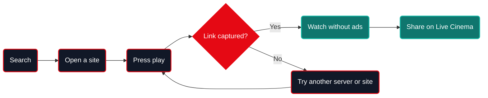

# Streamo

**Steal the stream. Skip the ads.**

Capture the direct link of any movie or series.
Watch it anywhere, or share it with friends.

---

## How It Works

## Quick Start

**1. Search**
Type `مشاهدة فيلم <name> اونلاين` in the app. You can add a site name at the end.

**2. Play**
Open any site from the results, choose your movie or episode, and press play.

**3. Capture**
A floating window appears and tests the stream link automatically.
If the test fails, switch to another server or site. If it passes, tap the link.

**4. Watch**
Open **Extracted Links** and play the link in the built-in player or in Chrome.

> Links expire after a while. Refresh the link or capture a new one.

Works the same on Windows and Android.

## Live Cinema

[**Live Cinema**](https://live-cinema.pages.dev/) is a separate free website for watching together in sync. It has no ads, admin controls, and a live chat.

Capture a link in Streamo, test it in Chrome, paste it into a Live Cinema room, and share the room link.

## Download

### 🪟 Windows
[**Streamo-v2.0.1-portable.exe**](https://github.com/X5Coder/Streamo/releases/download/windows-v2.0.1/Streamo-v2.0.1-portable.exe)
 Portable · No installation · 73 MB

 

### 🤖 Android
[**Streamo-v2.0.1-android.apk**](https://github.com/X5Coder/Streamo/releases/download/android-v2.0.1/Streamo-v2.0.1-android.apk)
 Android APK · 4.4 MB

---

Streamo does not host any content. It only captures links from websites you choose to visit. You are responsible for how you use it.

**Made by [X5Coder](https://github.com/X5Coder) · All rights reserved**

⭐ **If you like Streamo, give it a star.**

